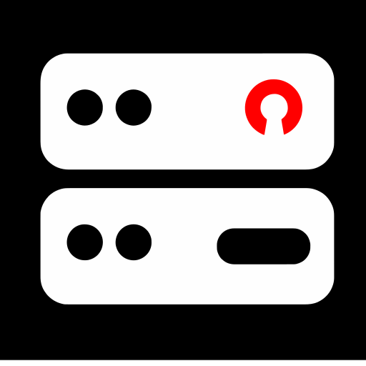
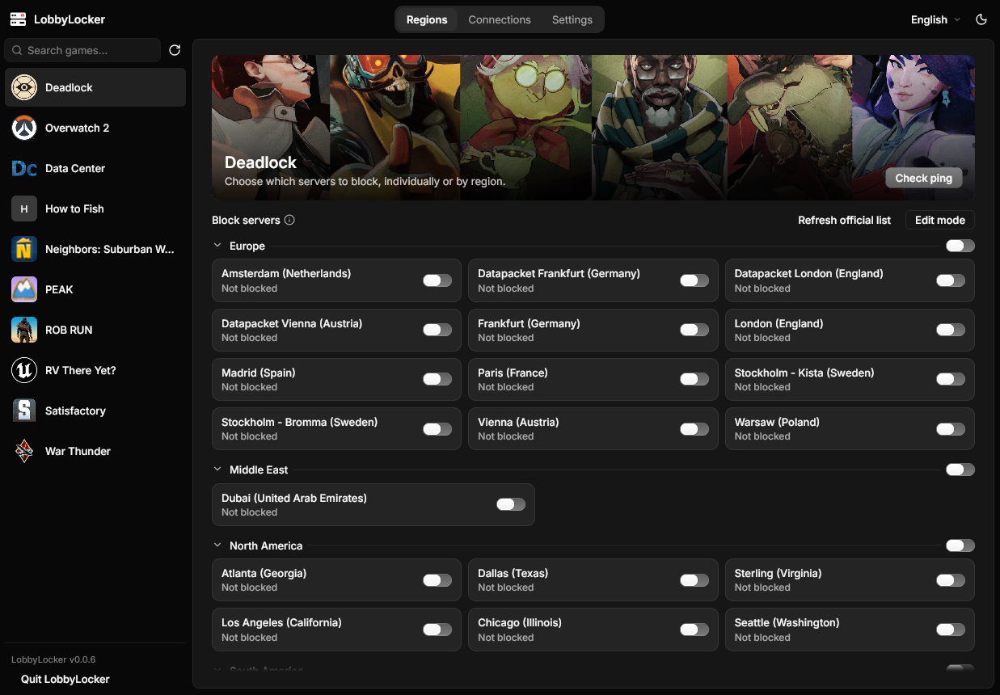

<div align="center">
  

  <h1>LobbyLocker</h1>

  <p><strong>Leave the lobby. Keep your latency.</strong><br />
  A lightweight game server region blocker for Linux and Windows.</p>

  <p>
    <a href="https://github.com/its4lion/LobbyLocker/releases/latest"><strong>Download for Windows or Linux</strong></a>
  </p>

  <p>
    <a href="https://github.com/its4lion/LobbyLocker/releases"></a>
    <a href="https://img.shields.io/badge/Built_with-Rust-1ed760"></a>
    <a href="https://img.shields.io/badge/Linux_%C2%B7_Windows-24292f"></a>
    <a href="LICENSE"></a>
  </p>
</div>

Supports **Deadlock**, **Counter-Strike 2**, **Overwatch 2**, and **Dead by
Daylight**, plus custom games you add yourself.

<div align="center">
    
</div>

## Download

Get the latest version from [GitHub Releases](https://github.com/its4lion/LobbyLocker/releases/latest).

| Platform                       | Package                |
| ------------------------------ | ---------------------- |
| Windows 11                     | NSIS `.exe` installer  |
| Ubuntu 24.04 LTS               | `.deb` package         |
| Arch Linux                     | `.pkg.tar.zst` package |
| Other compatible Linux systems | AppImage (best effort) |

> [!NOTE]
> **Arch Linux:** `lobbylocker-bin` is not available in the AUR yet. Download the
> `.pkg.tar.zst` from Releases, then run this in the folder containing the package:
>
> ```sh
> sudo pacman -U ./lobbylocker-*.pkg.tar.zst
> ```

Linux needs `nftables`, `pkexec`, and a working desktop polkit agent. Windows asks
for administrator access when it starts so it can change the firewall, and the
builds are unsigned, so SmartScreen may warn.

> [!NOTE]
> **Releases:** a release candidate is built as a **draft** on the
> [Releases page](https://github.com/its4lion/LobbyLocker/releases) and is
> published only when it is ready, so a stable release is always a build you
> have already tested. LobbyLocker does not update itself — install a newer
> release over the old one.

## How it works

LobbyLocker writes rules into the firewall your OS already runs. Game files are
never modified and nothing is injected into the game.

1. Open LobbyLocker and pick a game. Installed supported games are detected from
   local Steam and Epic metadata.
2. Turn on the switches for the servers or regions you **don't** want to play on.
   A region switch covers every bundled server in that region.
3. Approve the permission prompt. Switch changes apply automatically, and blocks
   stay active after you close the app.

Only LobbyLocker's own rules are ever touched. **Settings → Firewall → Reset**
removes them without flushing the rest of your firewall.

## What's included

- **Server and region switches** — block individual servers or a whole region.
  Server cards show the firewall readback (**Blocked** / **Not blocked**), not
  just the saved switch.
- **Blocking scope (Windows)** — block the selected game executables, or every
  app on the PC that talks to those addresses.
- **Refresh the official list** — pull a game's current server addresses from its
  provider feed. Endpoint IDs stay stable, so existing blocks are updated rather
  than duplicated.
- **Server editor** — add IPs or CIDR ranges, ports, a protocol, and a ping
  target. **Edit mode** edits bundled servers; **Add custom game** creates your
  own from scratch.
- **Check ping** — ICMP probes on demand. Results never change block selections.
- **Connections** — a read-only snapshot of current remote sockets, searchable by
  address, process, protocol, or port. It never scans automatically.
- **Game library** — use **Scan games** to find games installed after launch, and
  add extra **Game library folders** in Settings for other drives.
- **Small things** — dark mode, English and Arabic, local Steam banner art, and a
  compact layout when the window gets narrow.

## Tips

- The window is responsive: drag it below 720 points wide and it switches to the
  compact layout; widen it to go back. There is no separate toggle.
- Windows: **Settings → Blocking** switches between **Selected games** and
  **All apps on this PC**. All-apps blocking needs no executable and also covers
  other apps using the same addresses.
- Use **Settings → Game files** to point a game at its executable. Windows uses
  that executable to scope rules; Linux rules apply system-wide.
- Ping is an ICMP probe to the server's probe address, not in-game latency. Some
  targets may not reply.

## Before you play

> [!WARNING]
>
> - **Linux blocks addresses system-wide**, which can affect other apps. Windows
>   can scope rules to the selected game executables or apply them to all apps.
> - LobbyLocker is in beta. Server lists can go out of date, and parties or
>   relays can still put you in an unexpected region. If a match won't connect,
>   use **Reset**.
> - Test Overwatch blocking in a custom game, not the practice range.

## FAQ

| Question                         | Answer                                                                                                                                                                  |
| -------------------------------- | ----------------------------------------------------------------------------------------------------------------------------------------------------------------------- |
| Does it modify the game?         | No. It only writes OS firewall rules — no game files changed, no code injected.                                                                                         |
| A blocked region still connects? | Use **Refresh official list**, toggle the affected blocks off and back on, then queue a new match.                                                                      |
| Do I need administrator access?  | For firewall changes, yes. Windows asks when the app starts; Linux shows a polkit prompt via `pkexec`.                                                                   |
| How do I uninstall?              | Run **Settings → Firewall → Reset** first, then uninstall or delete the AppImage. Package removal also cleans up LobbyLocker's own firewall rules.                       |

Need help or have a suggestion? [Open an issue](https://github.com/its4lion/LobbyLocker/issues).

<details>
<summary>Build from source</summary>

Pure Rust: the app is a [Rune](https://github.com/anomalyco/rune) native desktop
app over a standalone core crate — no Node, no pnpm, no webview. Install Rust
1.99.1+ and your platform's Vulkan or OpenGL runtime for the window.

```sh
cargo run -p lobbylocker-app
```

Headless checks (no display needed):

```sh
cargo run -p lobbylocker-app -- --snap /tmp/lobbylocker-cs2.png --scene cs2
cargo run -p lobbylocker-app -- --tree /tmp/tree.json --scene cs2
cargo run -p lobbylocker-core --bin lobbylocker -- preview
```

Scenes: `cs2`, `blocked`, `settings`, `connections`, `empty`, `reset`, `edit`,
`edit-add`, `edit-details`, `compact`.

Release versions are written with `cargo run -p bump-version -- set <version>`;
never edit only one of `Cargo.toml` and `Cargo.lock`.

</details>

[MIT license](LICENSE)
