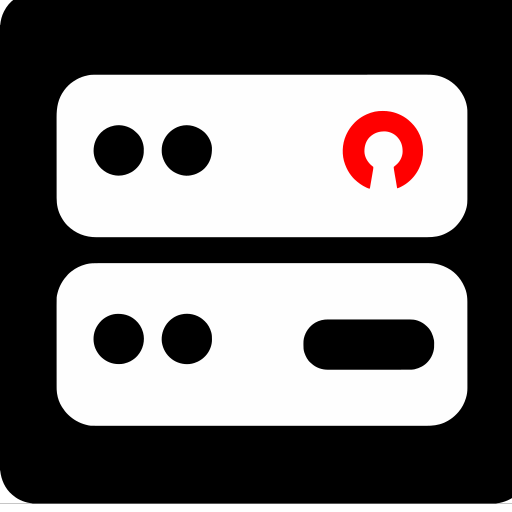
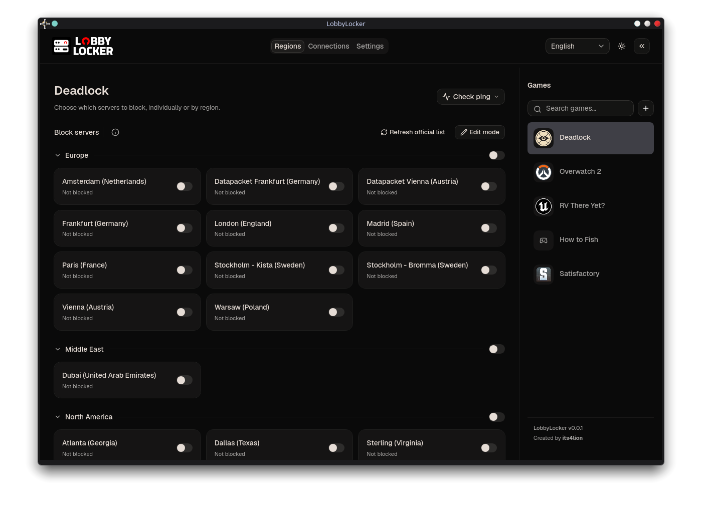

<div align="center">
  

  <h1>LobbyLocker</h1>

  <p><strong>Leave the lobby. Keep your latency.</strong><br />
  A lightweight game server region blocker for Linux and Windows.</p>

  <p>
    <a href="https://github.com/its4lion/LobbyLocker/releases/latest"><strong>Download for Windows or Linux</strong></a>
  </p>

  <p>
    <a href="https://github.com/its4lion/LobbyLocker/releases"></a>
    <a href="https://img.shields.io/badge/Built_with-Rust-1ed760"></a>
    <a href="https://img.shields.io/badge/Linux_%C2%B7_Windows-24292f"></a>
    <a href="LICENSE"></a>
  </p>
</div>

> [!WARNING]
> LobbyLocker is still in beta. Server addresses can change, Windows builds are
> unsigned, and blocking a shared IP range can affect other applications.

Supports **Overwatch 2**, **Deadlock**, and **Counter-Strike 2**, plus custom games.

<div align="center">
    
</div>

## Download

Get the latest version from [GitHub Releases](https://github.com/its4lion/LobbyLocker/releases/latest).

| Platform                       | Package                |
| ------------------------------ | ---------------------- |
| Windows 11                     | NSIS `.exe` installer  |
| Ubuntu 24.04 LTS               | `.deb` package         |
| Arch Linux                     | `.pkg.tar.zst` package |
| Other compatible Linux systems | AppImage (best effort) |

> [!NOTE]
> **Arch Linux:** `lobbylocker-bin` is not available in the AUR yet. Download the
> `.pkg.tar.zst` from Releases, then run this in the folder containing the package:
>
> ```sh
> sudo pacman -U ./lobbylocker-*.pkg.tar.zst
> ```

Linux needs `nftables`, `pkexec`, and a working desktop polkit agent. Windows
builds are unsigned and may show a SmartScreen warning.

## How to use

1. Download and open LobbyLocker, then choose your game. On Windows, choose
   the game's actual `.exe` if needed.
2. Turn on the switches for servers or regions you **don't** want to play on.
3. Approve the permission prompt. Switch changes apply automatically.

Blocks stay active after you close the app. Switch them off to unblock, or use
**Settings → Reset** (**Reset** in compact mode) to remove them all.

## More options

- **Compact mode:** use **Collapse app** / **Expand app** in the header.
- **Ping:** use **Check ping** to check all servers with a ping target or just
  one. Results appear in the cards and never change blocking selections.
  These are ICMP probe measurements, not in-game latency; some targets may not reply.
- **Server editing:** in expanded mode, **Edit mode** lets you add IPs and edit
  a server's addresses and ping target.

## Before you play

> [!WARNING]
>
> - **Linux blocks addresses system-wide**, which can affect other apps. Windows
>   blocks only the game executable you select.
> - LobbyLocker is in beta. Server lists can go out of date, and parties or relays
>   can still put you in an unexpected region. If a match won't connect, use
>   **Reset**.
> - Test Overwatch blocking in a custom game, not the practice range.

## FAQ

| Question                         | Answer                                                                                                                                                                     |
| -------------------------------- | -------------------------------------------------------------------------------------------------------------------------------------------------------------------------- |
| Does it modify the game?         | No. It uses your OS firewall — no game files changed, no code injected.                                                                                                    |
| A blocked region still connects? | Expand the app, then use **Refresh cloud ranges** (Overwatch) or **Refresh official list** (Deadlock/CS2). Toggle affected blocks off and back on, then queue a new match. |
| How do I uninstall?              | Use **Settings → Reset** (**Reset** in compact mode), wait for confirmation, then uninstall or delete the AppImage.                                                        |

Need help or have a suggestion? [Open an issue](https://github.com/its4lion/LobbyLocker/issues).

<details>
<summary>Build from source</summary>

Install Rust 1.90+, Node.js 22.12+, pnpm 10.17.1, and the
[Tauri prerequisites](https://v2.tauri.app/start/prerequisites/) for your platform.

```sh
pnpm install
pnpm dev
```

</details>

[MIT license](LICENSE)
